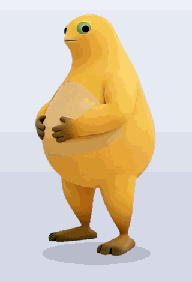

桌宠 / Desktop Pet

一个 Windows 桌面宠物：点击它播放捧腹大笑动画和笑声，可拖动、可隐藏、
可调节大小、可开机自启，系统托盘常驻。

技术栈：Python + PySide6（透明置顶窗口、序列帧动画、QSoundEffect 音效）
素材管线：白底录屏视频 → ffmpeg 抠像 → 自动去白边/去地面阴影 → WebP 序列帧

仓库地址：https://github.com/zzaibc134/naiwa-pet-for-windows

两种装法

方式一：免安装版（不用装 Python）

👉 [下载 v1.0.0 Release](https://github.com/zzaibc134/naiwa-pet-for-windows/releases/latest)
→ 解压 → 双击 奶娃桌宠.exe
（首次运行若提示"已保护你的电脑"，点 更多信息 → 仍要运行）

方式二：从源码跑（需要 Python 3.10+）

bat
git clone https://github.com/zzaibc134/naiwa-pet-for-windows.git
cd naiwa-pet-for-windows
pip install -r requirements.txt
python src/main.py


⚠️ 版权说明（必读）

  本仓库代码采用 MIT 许可证。
  assets/ 里的角色形象、动画、笑声、语音是第三方作品（奶娃），
  本仓库未获授权。这是仓库主人的明确决定：仅供个人学习与朋友间玩耍，
  无授权商用；如版权方提出，仓库会立即移除相关素材。
  你下载后同样只建议自用。若你要公开传播或二次分发，请先把素材拿掉：
  .gitignore 里恢复 assets/pet/*、assets/raw/ 两行排除，
  或让使用者改跑 python tools/make_placeholder.py 生成原创占位角色。
  换你自己的角色：往下看「素材 SOP」，一段白底视频就能整套重做。


三分钟跑起来

bash
pip install -r requirements.txt
python src/main.py        # 素材就在仓库里，clone 完直接跑


如果不会命令行-> 装好 [Python](https://www.python.org/downloads/)
（勾选 "Add python.exe to PATH"）后双击 快速开始.bat。

或者让 AI 助手替你装（最省事）

把下面这段话原样复制给你电脑上的豆包 /codex/deepseek harness/Zcode 等 AI工具，
地址已经填好了：

> 帮我在这台 Windows 电脑上把桌宠跑起来，全程自己执行并修错：
> 1. `git clone https://github.com/zzaibc134/naiwa-pet-for-windows.git`
>    （git 不通就下载 https://github.com/zzaibc134/naiwa-pet-for-windows/archive/refs/heads/main.zip 解压）
> 2. 没有 Python 就先装 3.10+（https://www.python.org/downloads/ ，勾选 Add to PATH）
> 3. 项目目录里执行 `python -m venv .venv`
> 4. `.venv\Scripts\python -m pip install -r requirements.txt`
>    （慢就加 `-i https://pypi.mirrors.ustc.edu.cn/simple/`）
> 5. 素材就在仓库里，直接启动：`start .venv\Scripts\pythonw.exe src\main.py`
> 6. 验收：屏幕右下角应出现一只奶龙桌宠；再跑 `.venv\Scripts\python tests\smoke_test.py`，
>    应输出"全部 18 项冒烟测试通过"。不对就按报错自行排查修复。



想换成自己的角色（或把仓库变成"纯代码"模式）：
`python tools/make_placeholder.py --force` 生成原创占位角色顶替素材。

---

常见问题

| 症状 | 原因 / 解决 |
|---|---|
| `快速开始.bat` 双击一闪而过 | 在文件夹空白处右键 →「在终端中打开」→ 输入 `快速开始.bat`，就能看到真正的报错 |
| `pip install` 卡住或超时 | 换国内镜像：`pip install -r requirements.txt -i https://pypi.mirrors.ustc.edu.cn/simple/` |
| `git clone` 卡住 / 连不上 | 开加速器，或浏览器直接下 ZIP：仓库页 `Code` →`Download ZIP` |
| 桌面上出现的是**蓝色小蛋**，不是奶娃 | 素材被占位角色顶替了。在项目目录执行 `git checkout -- assets` 恢复 |
| 桌宠不见了 / 想临时藏起来 | 托盘图标左键切换，或按 `Alt + Shift + H`；右键菜单里还有「回到右下角」 |
| 点击有动作但没声音 | 右键菜单看「静音」是否被勾上；再看系统音量混音器里本程序的音量 |
| 想让它别上下浮动 | 右键 →「静止（不上下浮动）」，设置会记住，下次启动仍生效 |

---

功能

| 操作 | 效果 |
|---|---|
| 左键单击 | 播放捧腹大笑动作 + 笑声（播放中再点会重播） |
| 左键拖动 | 把桌宠拖到任意位置 |
| 右键菜单 | 大小（小/标准/大）、静止（不上下浮动）、音频（三句语音）、静音、开机自启、隐藏、回到右下角、退出 |
| 音频 | 点一句就让桌宠边说边动嘴：口型按音频能量逐帧驱动，说完自动闭嘴 |
| 托盘图标 | 左键点托盘 = 显示/隐藏；右键托盘 = 菜单 |
| 全局快捷键 | `Alt + Shift + H` 隐藏/显示桌宠 |
| 待机 | 缓慢上下浮动（亚像素，不会一顿一顿）+ 随机眨眼（2.2~6 秒一次，15% 连眨两下） |
| 静止 | 勾上后 "停止上下浮动"（眨眼、语音、点击大笑照常），状态记进设置，重启仍生效 |
| 其他 | 透明区域鼠标穿透、不抢焦点、始终置顶、位置和设置自动记忆 |

> 「静止」不是"暂停当前动作"，而是一个独立的常驻状态：勾上后浮动增益渐降到 0
> （约 0.13 秒，不弹跳），取消后渐入恢复，同样不会突然开始飘。
> 说话期间会临时跳过眨眼调度，不会出现"边说话边眨眼"的打架。

---

一、直接运行（开发者）

需要 Python 3.10+（建议 3.11 或 3.12）和 ffmpeg。

```bash
pip install -r requirements.txt
# 素材按下面"素材处理"一节准备好后：
python src/main.py
```

---

 二、素材处理（视频 → 序列帧）

素材准备要求：

1. 一段**纯白背景**的竖屏视频（纯色背景，不要有杂色、纹理）；
2. 动作是一整段连续表演（例如 17 秒捧腹大笑），动作结束后有一个
   回到待机姿势的静止画面；
3. 用手机录屏时，先把视频里的状态栏、App 按钮、水印位置确认好，
   后面用 `--crop` 参数裁掉。

安装处理素材用的依赖：

```bash
pip install -r requirements-dev.txt
```

确认 ffmpeg 已安装并在 PATH 中（命令行输入 `ffmpeg -version` 有输出）。

处理命令：

```bash
python tools/process_assets.py assets/raw/你的视频.mp4 ^
  --action-start 0 --action-end 17 ^
  --idle-time 17.5 ^
  --crop 80:310:560:940 ^
  --width 560 ^
  --key white --similarity 0.11 --blend 0.25 ^
  --audio ^
  --out assets/pet

python tools/make_blink.py        # 从 idle.webp 生成眨眼帧（可选）
```

> Windows 命令行里 `^` 是换行符，写成一行也可以。

参数说明：

| 参数 | 含义 |
|---|---|
| `--action-start / --action-end` | 动作片段在视频中的起止时间（秒） |
| `--idle-time` | 待机姿势出现在第几秒（取那一帧作为静态待机） |
| `--crop x:y:w:h` | 从视频画面中裁出角色区域，去掉录屏 UI 和水印（`x:y` 为左上角，`w:h` 为尺寸） |
| `--width` | 输出帧宽度。**取显示宽度的 2 倍**：标准档显示 280 宽，125%/150% 高分屏上是 350~420 物理像素，素材只给 280 就会被放大显示、边缘阶梯全暴露 |
| `--key white` | 抠除白色背景；绿幕可写 `0x00ff00` |
| `--similarity` | 抠像容差，按素材背景实际有多白来调（本素材 0.11），调太大会误抠浅色肚皮 |
| `--blend` | colorkey 的边缘过渡宽度（本素材 0.25） |
| `--feather` | alpha 抗锯齿羽化 sigma，默认 0.8，设 0 关闭 |
| `--quality` | WebP 有损质量，默认 88 |
| `--no-premul` | 关闭预乘缩放（默认开启，见下） |
| `--audio` | 同时导出动作段音频为 `laugh.wav` |

处理后 `assets/pet/` 会生成：

- `idle.webp`：待机帧
- `laugh/0000.webp ~ 0509.webp`：动作序列帧（30fps）
- `blink/00.webp ~ 04.webp`：眨眼帧（由 `tools/make_blink.py` 生成，可选）
- `laugh.wav`：笑声

脚本自动完成：抠白 → 去白边 → 去地面阴影（含脚底暖色阴影块）→ 浅色区域保护
→ 椭圆核内缩 → alpha 羽化 → 透明区颜色外扩 → 预乘缩放 → WebP。

边缘质量的四个关键点

1. **腐蚀必须用椭圆核**。PIL 的 `MinFilter` 是方形结构元，对曲线轮廓腐蚀会啃出
   一格一格的方角缺口，就是那种"割裂纹"。实测折角密度从每 1000 像素周长 11.2 个
   降到 8.4 个。
2. **alpha 要羽化**。二值硬边在显示端被放大哪怕 1.25 倍都会露出锯齿台阶；
   对 alpha 做一次 σ≈0.8 的高斯，不透明区仍不透明、透明区仍透明，只有边缘
   1~2px 变成渐变，缩放器才有东西可平均。
3. **透明像素的 RGB 不要清零**。塞黑会让缩放把暗色平均进轮廓、塞白会裹一圈
   浅灰毛边；正确做法是把角色自身颜色外推进透明区（`spread_opaque_color`）。
   渲染时 alpha=0 的像素不参与合成，所以这一步只影响缩放和编码，不改变画面。
4. **缩放必须预乘**。PIL 的 `resize` 直接在非预乘 RGBA 上插值，等于把透明区
   颜色混进半透明边缘；`resize_rgba_premultiplied` 先预乘再缩放再反预乘。

顺带一条被实测否掉的猜测：**WebP 有损模式下的 alpha 通道本身就是无损存储的**
（往返后 alpha 差异 0 像素），不需要为 alpha 单独调参数；边缘损伤全部来自
RGB 色度。

 最危险的一个坑：桌宠皮肤被穿透

`--similarity` / `--blend` 调大以后，**浅色角色会被自己抠穿**：奶油肚皮和白色
背景本来就分不太开，抠像一松，肚皮就成了透明；再去擦地面阴影的泛洪会顺着
这圈半透明边缘当桥灌进身体，把洞扩大到上万像素。肉眼看缩略图完全正常，
**必须放到有内容的背景上才看得出来**。

本项目的实测数字：

| 参数 | 肚皮被抠穿的像素 | 备注 |
|---|---|---|
| `0.02 / 0.05` | 0 | **采用**。体检：误伤残留 0、抠穿嫌疑 0 |
| `0.11 / 0.25` | 19,732 | 肚皮整块没了，只能靠补洞救回 |

管线里有三道防线，都在 `fix_edges`：

1. 擦阴影的泛洪**只清 alpha、保留 RGB**（colorkey 本来也不改 RGB）。
2. `fill_interior_holes`：把"被身体包住、且**擦阴影之前是实心**"的洞按原色补回
   alpha —— 原色还在，不需要猜。
3. 核心填洞（`core_fill`）把身体内部还半透明的像素补实。

**第 2、3 步的依据必须分开，这是本项目最隐蔽的一个坑：**

| 步骤 | 该用什么判据 | 用错的后果 |
|---|---|---|
| `fill_interior_holes` | **`pre`**（动手之前的 alpha） | 用当前 alpha 补不了泛洪误伤的洞 |
| `core_fill` | **当前** alpha（> 128） | 用 `pre` 会把刚擦掉的地面阴影**整块填回来** |

实测数据：把 `core_fill` 的判据从当前 alpha 换成 `pre` 之后，脚下立刻多出
**10,562 像素的不透明卡其色块**（均色 `(168,146,116)`），也就是"脚底那块地垫"。
因为地面阴影在抠像时本来是不透明的，`pre` 认定它是身体核心，擦完又给填了回去。

**为什么不能用颜色当判据**：这个角色两腿之间、手臂与肚皮之间存在完全封闭的
**暖色阴影缝隙**，实测平均饱和差 65、均色 `(176,147,111)` —— 比奶油肚皮
（饱和差 40、均色 `(251,236,211)`）还"有颜色"，用颜色判会把该透的地方糊成一块布。
而两者 `pre` 分别是 42 和 255，一眼分开。

同理，体检也必须排在**颜色外扩之前**：`spread_opaque_color` 会把角色色推进
透明区，之后再看颜色，13,000 像素的合法腿间口袋也会变得"又大又亮又有角色色"。

处理完每一帧脚本会打印两类数字并据此中止：

| 指标 | 含义 | 处置 |
|---|---|---|
| 误伤残留 | 泛洪抹掉了实心身体却没补回来 | 管线 bug，查 `pre` 判据 |
| 抠穿嫌疑 | colorkey 自己把浅色身体抠没了 | 补不回来，只能调小 `--similarity/--blend` |

全量复查成品：

```bash
python tools/scan_holes.py            # 退出码非 0 = 存在疑似被抠穿的身体
```

### 如何确定 crop 参数

1. 用播放器截一张视频画面，量出角色区域在画面中的左上角坐标和宽高；
2. 先试一个保守值跑一遍，检查输出帧有没有残留 UI/水印或裁到角色；
3. `--idle-time` 拖动播放器进度条找到待机姿势出现的时间点即可。

---

## 三、打包成 Windows exe

**在 Windows 电脑上操作**（PyInstaller 不能跨平台打包）：

1. 安装 Python 3.10+：官网 https://www.python.org/downloads/ 下载，
   安装时**勾选 "Add python.exe to PATH"**，然后点 Install Now。
2. 安装 ffmpeg（仅素材处理需要；只打包时不用）：
   https://www.gyan.dev/ffmpeg/builds/ 下载 release-essentials 压缩包，
   解压后把里面的 `bin` 目录加入系统 PATH。
3. 把整个项目文件夹放到电脑上，确认素材已在 `assets/pet/` 下。
4. **双击 `build.bat`**，它会自动安装依赖并打包。
5. 打包完成后，可执行文件在：

   ```
   dist\nailong-pet\nailong-pet.exe     （PyInstaller 6：同级多一个 _internal 目录）
   ```

6. 把整个 `dist\nailong-pet` 文件夹压缩成 zip 发给朋友，
   朋友**解压后双击 exe 即可运行**，不需要安装 Python。

### 实测数据（本项目这一版）

| 项 | 值 |
|---|---|
| 打包后体积 | 159.6 MB → 精简后 **113.4 MB** |
| zip 压缩后 | **55.9 MB** |
| 首次启动内存 | 约 95–100 MB |
| 打包版音频 | `QSoundEffect` 状态全部 `Ready`（笑声 + 三句语音） |

`build.bat` 里已经包含精简步骤：删 `opengl32sw.dll`（19.7 MB，不用 OpenGL）、
`Qt6Quick/Qml/Pdf`（已被 `--exclude-module` 排除但 DLL 仍会被拷进来）、
`translations/`（7 MB，没有多语言界面）、以及非 webp 的图片插件
（**`plugins\imageformats\qwebp.dll` 必须保留**，素材全是 webp）。

两个容易踩的坑：

- `--add-data` 在 PyInstaller 6 里要用**冒号**：`--add-data "assets\pet:assets/pet"`，
  老教程里的分号写法会直接报 `Wrong syntax`。
- `--windowed` 下 `sys.stdout` 是 `None`，任何 `print()` 都会抛异常。
  `src/main.py` 里统一走 `log()` 包裹，别直接 print。

### 打包后怎么自检

```bat
rem 音频后端是否加载成功（写成 status=Ready 就对了）
set PET_SOUND_REPORT=%TEMP%\sound.txt
nailong-pet.exe
type %TEMP%\sound.txt
```

程序带**单实例锁**：重复双击不会再冒出一只，第二次启动会直接退出。

### 发给朋友时的注意事项

- 一定要发**整个文件夹**（里面有运行所需的 DLL 和资源），不能只发 exe。
- 朋友首次运行时如果 Windows 弹出"已保护你的电脑"（未签名程序），
  点"更多信息" → "仍要运行"。这是未购买代码签名证书的正常现象。
- 360/电脑管家可能误报，添加信任即可。
- 开机自启：右键桌宠 → 勾选"开机自启"，下次开机自动出现。
- 彻底卸载：右键托盘 → 退出 → 取消开机自启 → 删文件夹 →
  （可选）删注册表 `HKCU\SOFTWARE\nailong-pet`。

---

## 目录结构

```
nailong-pet/
├── src/main.py              # 桌宠主程序
├── tools/process_assets.py  # 素材预处理：白底视频 → 透明序列帧
├── tools/make_blink.py      # 从待机帧生成眨眼帧（自动定位眼睛 + 眼睑合成）
├── tools/make_talk.py       # 从待机帧生成张嘴帧（透镜形开口 + 上下唇描边）
├── tools/make_voice.py      # 语音入库：复制 wav + 按能量算出逐帧张嘴量曲线
├── tools/make_placeholder.py# 原创占位角色「蛋蛋」+ 图标（开箱即玩的关键）
├── tools/scan_holes.py      # 素材体检：查身体有没有被抠穿
├── tools/fix_feet_shadow.py # 事后修补：只清脚底暖色阴影块，不重新抽帧
├── tests/smoke_test.py      # 无头冒烟测试
├── docs/demo.gif            # README 演示图（仅含原创占位角色）
├── 快速开始.bat              # 双击：建环境→装依赖→生成蛋蛋→启动
├── assets/
│   ├── raw/                 # 原始视频（SOP 的输入样例）
│   └── pet/                 # 运行素材（第三方角色，自用，见版权说明）
│       ├── idle.webp
│       ├── laugh.wav
│       ├── laugh/
│       ├── blink/
│       ├── talk/            # 张嘴帧（6 档）
│       └── voice/           # 三句语音 + curves.json（逐帧张嘴量）
├── build.bat                # Windows 一键打包
├── requirements.txt         # 运行依赖
├── requirements-dev.txt     # 素材处理依赖
├── LICENSE
└── README.md
```

---

## 语音与说话口型

右键「音频」里那三句来自用户提供的录屏。语音和口型都不需要额外美术素材：

1. **切音频**：按能量包络找句子边界（合并句内 <0.42s 的停顿），切出来后
   按内容裁掉多余空白、首尾 8ms 淡入淡出、峰值统一到 -3 dBFS。
2. **生成张嘴帧**（`tools/make_talk.py`）：待机帧的嘴是一条 39×5 的深色细线；
   对嘴以下施加**纵向位移场**（下颌下沉、脸颊平滑收边），那条线被拉成开口，
   再把开口压暗到大笑帧实测的口腔色 `(45,20,9)`。这正是真实动画里"张嘴"的原理。
3. **口型驱动**（`tools/make_voice.py`）：把每句语音的 RMS 包络按 30fps 采成
   0~1 的张嘴量，存进 `voice/curves.json`；运行时按播放进度取曲线、映射到 6 档
   张嘴帧。伽马取 1.8：取小于 1 会让整句停在"大张"档，看起来像一直在喊。

跑冒烟测试会验证"说话过程中张嘴档位确实在变、说完复位"。

张嘴幅度用 `tools/make_talk.py --max-open <像素>` 调（560 画布下的最大下沉量），
实测 15 偏小、**20~25 自然（默认 25）**、30 以上下巴会被拉长、下唇变成一条厚带：

```bash
python tools/make_talk.py --preview preview.png    # 换幅度后先看预览再定
```

---

## 调手感

`src/main.py` 的 `PetWindow` 顶部几个类常量就能改性格，不用碰逻辑：

| 常量 | 默认 | 作用 |
|---|---|---|
| `IDLE_FLOAT_PX` | `5.0` | 待机上下浮动幅度（逻辑像素，支持小数） |
| `FLOAT_PERIOD` | `3.2` | 浮动周期（秒）。调大更慢更飘，调小更活泼 |
| `FLOAT_MARGIN` | `6` | 窗口上下留白，必须 ≥ `IDLE_FLOAT_PX + 1` |
| `BLINK_GAP_S` | `(2.2, 6.0)` | 两次眨眼的随机间隔秒数 |
| `BLINK_DOUBLE_P` | `0.15` | 连眨两下的概率 |
| `DESIGN_WIDTH` | `280` | 显示基准宽度；素材宽度是它的几倍，运行时就自动按几倍超采样显示 |
| `SCALE_LEVELS` | 小 0.75 / 标准 1.0 / 大 1.4 | 右键菜单里的三档大小 |

浮动为什么用浮点：早期版本写的是 `int(3 * sin(...))`，一个 5 秒周期里只有 5 个
位置，两端各停 1.3 秒、中间"啪"地跳过，看起来就是一顿一顿。改成连续浮点 +
`QRectF` 亚像素绘制后，实测位置级数从 6 涨到 12、最长停顿从 27 帧降到 5 帧。

「静止」是运行时开关（设置键 `HKCU\SOFTWARE\nailong-pet\pet` 里的 `static`），
不是常量。它只压浮动增益，所以眨眼、点击大笑、拖动都不受影响。若要让静止连
眨眼一起停，在 `_idle_source()` 开头加一句 `return self.idle_img, ""` 即可。

---

## 扩展更多动作

当前程序内置"待机 + 一个点击动作"。加新动作的方法：

1. 用同样的背景和机位录新视频，分别处理成序列帧目录，
   例如 `assets/pet/happy/`、`assets/pet/angry/`；
2. 在 `src/main.py` 的 `PetWindow` 里参照 `play_laugh()` 增加新状态和
   触发方式（例如双击、定时随机触发、右键菜单切换）。

素材格式约定：所有帧与 `idle.webp` 保持**相同尺寸**、角色脚底对齐，
切换时才不会跳位——`process_assets.py` 已用统一包围盒保证这一点。
